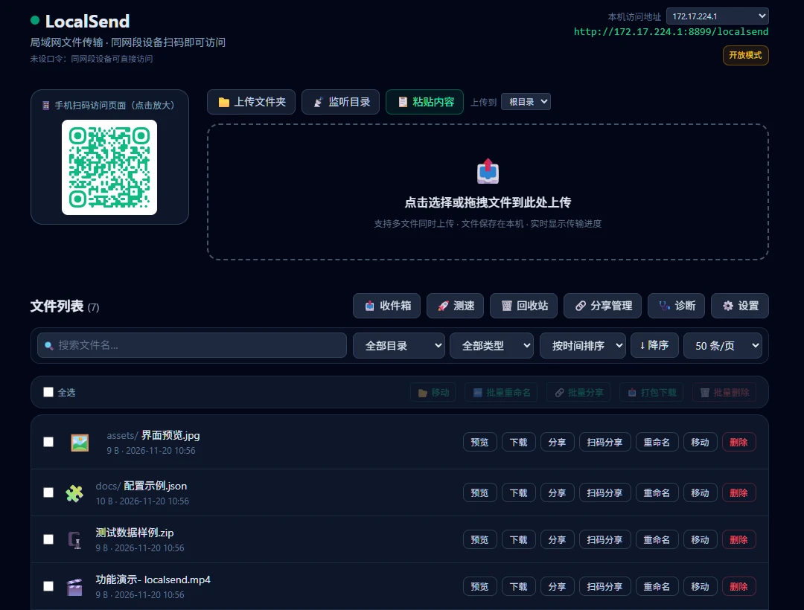

<div align="center">

[][npm-url]

# sserver

**一条命令，把任意目录变成一台开发服务器。**

[![NPM version][npm-badge]][npm-url] [![node version][node-badge]][node-url] [![npm download][download-badge]][download-url] [![GitHub stars][stars-badge]][stars-url] [![GitHub issues][issues-badge]][issues-url]

</div>

静态托管、自签 HTTPS、代理转发、支持PHP是标配。零配置起步随启随用，支持自定义复杂需求能力扩展。

特色功能`--localsend` 开启局域网文件快速分享互传，是其区别于普通静态服务器的地方。

## 快速开始

```bash
npx @lzwme/sserver -d ./dist
```

终端打印访问地址，浏览器打开即用，仅此而已。

```bash
# 也支持全局安装 / 项目内安装
npm i -g @lzwme/sserver      # 全局安装，然后使用命令：ss
npm i -D @lzwme/sserver      # 项目内安装，然后使用命令：npx ss
```

## 核心能力

| 能力 | 说明 |
| --- | --- |
| **静态托管** | 指定目录即用，目录浏览、SPA 回退开箱即得 |
| **自签 HTTPS** | `--https` 自动签发证书，手机端解锁剪贴板、通知、PWA |
| **代理转发** | 一份 `ss.config.js` 解决跨域与内网接口转发 |
| **LocalSend** | 局域网文件互传，扫码即用，能力对标商业工具 |
| **支持PHP** | 内置PHP代理解析规则（需已全局安装PHP） |

## LocalSend · 局域网文件传输

同网段设备扫码互传文件，是 sserver 的核心能力。上传、下载、预览、分享、整理、WebDAV 挂载一应俱全，权限分级与访问防护按需收紧。



```bash
ss --localsend
```

- 多文件 / 整目录上传，大文件分片并发 + 断点续传，进度实时可见
- 在线预览图片 / PDF / 音视频，批量打包 zip（中文名不乱码），手机端系统分享
- 分享链接与扫码分享，`Ctrl+V` 粘贴文本 / 截图即分享
- 网页端文件整理：重命名、移动、批量重命名、回收站还原
- WebDAV 网络盘，可挂载到资源管理器 / 访达 / 手机文件 App
- 令牌 + 管理员 / 访客口令分级，限流、配额、类型拦截、审计日志
- PWA 安装到桌面，文件到达实时通知，局域网测速

> 完整功能、访问防护、HTTPS、分享、WebDAV、分片续传等说明见 [LocalSend 使用指南](docs/localsend.md)。

## 参数与配置

### 命令行参数

| 参数 | 说明 |
| --- | --- |
| `-d, --root-dir <dir>` | 静态服务根目录，默认当前目录 |
| `-p, --port <port>` | 端口，默认 80（HTTPS 下 443） |
| `-a, --autoindex` | 开启目录列表浏览 |
| `-H, --https` | 启用 HTTPS，自动按 host 签发自签证书 |
| `--host <host>` | 服务域名，默认 `localhost` |
| `-o, --open` | 启动后自动打开首页 |
| `--coop-coep` | 启用跨域隔离（COOP / COEP） |
| `--localsend` | 开启 LocalSend 局域网文件互传 |
| `--localsend-dir <dir>` | LocalSend 文件存储目录 |

`ss init` 生成配置文件，`ss fix-localsend-names` 修复存储目录里的乱码文件名，完整参数见 `ss --help`。

### 配置文件

需要代理转发或深度定制时，在目录里执行 `ss init` 生成 `ss.config.js`。配置按「内置默认值 → 用户级 → 项目级 → 命令行」顺序覆盖，对象深合并。

```js
// ss.config.js
module.exports = {
  port: 8888,
  proxyConfig: [{
    api: '/proxy/cgi-bin/webhook/send',
    config: {
      target: 'https://qyapi.weixin.qq.com',
      changeOrigin: true,
      pathRewrite: { '^/proxy/cgi-bin': '/cgi-bin' },
    },
  }],
};
```

- 全部配置项、加载优先级与合并规则 → [配置参考](docs/config.md)
- LocalSend HTTP API 清单 → [API 参考](docs/api.md)

## 开发

```bash
git clone https://github.com/lzwme/static-server.git
pnpm install
pnpm build

pnpm dev          # bun 直接运行 TS 源码
pnpm dev:watch    # 改动自动重启
pnpm typecheck    # 类型检查
pnpm lint         # 代码检查
pnpm test         # 自动化测试（先构建再运行）
```

开发模式依赖 [bun](https://bun.sh/) 直接执行 TypeScript，无需编译。

欢迎提交 issue 与 PR。

## License

[MIT](LICENSE) · 由[志文工作室](https://lzw.me)开发和维护。

[stars-badge]: https://img.shields.io/github/stars/lzwme/static-server.svg
[stars-url]: https://github.com/lzwme/static-server/stargazers
[issues-badge]: https://img.shields.io/github/issues/lzwme/static-server.svg
[issues-url]: https://github.com/lzwme/static-server/issues
[npm-badge]: https://img.shields.io/npm/v/@lzwme/sserver.svg?style=flat-square
[npm-url]: https://npmjs.org/package/@lzwme/sserver
[node-badge]: https://img.shields.io/badge/node.js-%3E%3D20-green.svg?style=flat-square
[node-url]: https://nodejs.org/download/
[download-badge]: https://img.shields.io/npm/dm/@lzwme/sserver.svg?style=flat-square
[download-url]: https://npmjs.org/package/@lzwme/sserver
